# DeftSQL for SSMS 22

**DeftSQL** is a productivity extension for **SQL Server Management Studio 22**. It helps you write,
format, check, refactor and navigate T-SQL faster, right inside the SSMS query editor.

**Download:** [DeftSQL.vsix](https://github.com/qasimshah0321/Setups/raw/main/DeftSQL/DeftSQL.vsix) (version 2.9.0)

SHA-256: `547FE69444E3A9611A85D45E541B8DFF86D76906C59189A33A3118F4D9E1BA05`

**Product guide:** [DeftSQL-Product-Guide.docx](https://github.com/qasimshah0321/Setups/raw/main/DeftSQL/DeftSQL-Product-Guide.docx) (Word, every feature with its menu path and screenshots)

**Jump to:** [Features](#what-deftsql-can-do) · [Keyboard shortcuts](#keyboard-shortcuts) · [Version history](#version-history) · [Installation](#installation)

> **Previously called QueryCraft.** DeftSQL 2.0 is the same product under a new name. If you installed QueryCraft, uninstall it first (close SSMS, then run in Command Prompt):
>
> ```
> "C:\Program Files\Microsoft SQL Server Management Studio 22\Release\Common7\IDE\VSIXInstaller.exe" /uninstall:QueryCraft.SSMS.4b8f2c1e-7a3d-4e5f-9c6b-2d1a0e9f8b7c
> ```
>
> Your settings, snippets and history are carried over automatically.

---

## What DeftSQL can do

### Smart code completion
- Suggests tables, views, functions and stored procedures as you type, and adds a short alias after `FROM` / `JOIN`.
- Suggests the columns of the tables in your query, qualified with the right alias.
- Builds complete **`JOIN … ON`** conditions from your foreign keys.
- Adds a parameter template after `EXEC`.
- **Parameter info:** while you type a call to a stored procedure or function, a tooltip shows its parameters and highlights the one you are typing.
- Also completes variables, CTEs, temp tables, data types, `INSERT` column lists and keywords.
- **Learns what you use:** tables, columns and procedures you pick often move to the top of the list.
- **Hide clutter:** list patterns such as `Archive.*` or `tmp_*` in the options and those objects never appear.
- **Other databases:** type `OtherDb.` for its schemas, `OtherDb.dbo.` for its tables and `OtherDb.dbo.Table.` for its columns.
- While the list is open:
  - **Ctrl+Up / Ctrl+Down** filter it: tables, columns, procedures, variables, schemas, keywords or snippets.
  - **Ctrl+Right** opens a column picker. Tick the columns you need and press Enter to insert them.
- Put the caret after `SELECT *` and press **Tab** to **expand the wildcard** into the full column list.


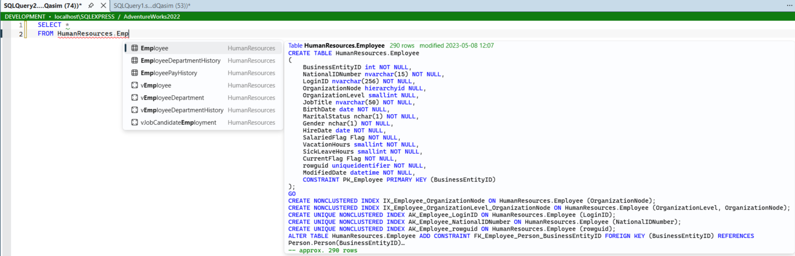

*Typing `FROM HumanResources.Emp`: matching tables and views, with the selected table's script, indexes and row count.*

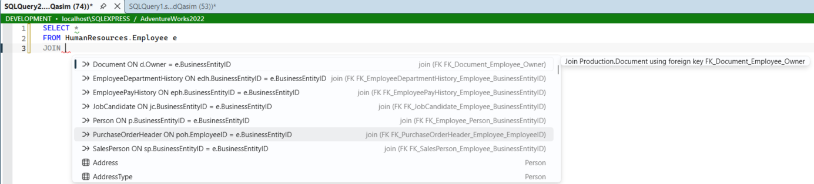

*After `JOIN`, ready-made join conditions from the foreign keys.*

### Snippets
- 140 built-in snippets: type a shortcut and press **Tab**. They cover queries, joins, CTEs, DDL (columns, keys, indexes, triggers), dates, JSON and XML, error handling and DBA checks such as blocking, waits, index fragmentation, backups and jobs.
  - For example, `ssf` gives `SELECT * FROM`, `st100` gives `SELECT TOP 100`, and `cte` gives a CTE template.
  - Others cover transactions (`bt`), try/catch (`tc`) and `MERGE` (`mrg`).
- Placeholders fill themselves in: cursor position, selected text, date and time, user, server, database, a new GUID, and the clipboard.
- A Snippet Manager creates and edits snippets and imports or exports them. *Surround with snippet* wraps your selection.
- A shared snippets folder lets a whole team use one set of snippets.

### SQL formatting
- **Ctrl+K, Ctrl+Y** formats the whole script or just the selection.
- Six built-in styles plus a fully custom style, with a live preview window.
- Styles can be imported and exported, and format-on-paste is optional.
- Option to write table, column and procedure names exactly as they are defined in the database (`dbo.customers` becomes `dbo.Customers`).
- More layout options: space after commas, spaces inside parentheses, aligned column aliases and short statements on one line.
- **Team styles:** point DeftSQL at a shared folder and everyone gets the same styles.
- **Format SQL Files…** formats every `.sql` file in a folder in one go.
- A safety check refuses any formatting that would change the meaning of your code.
- **Code folding:** collapse `--region name` … `--endregion` blocks, `BEGIN … END`, `TRY/CATCH`, `CASE` and long comments in long scripts.


| Before | After **Ctrl+K, Ctrl+Y** |
|---|---|
| 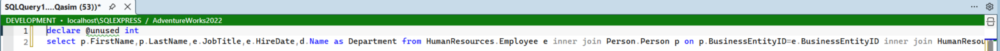 | 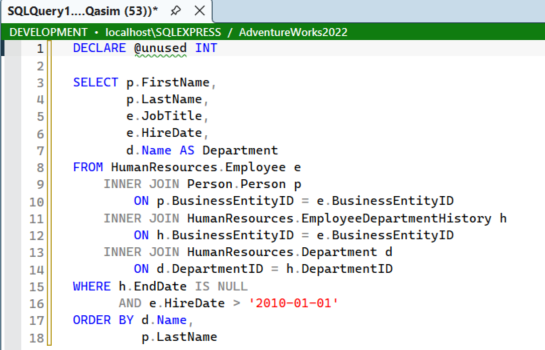 |

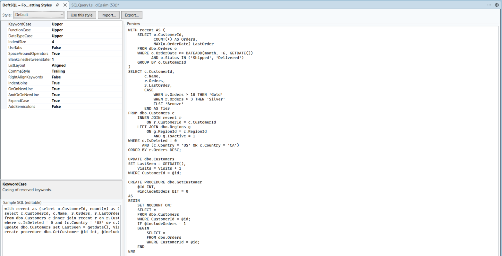

*Formatting Styles: settings on the left, live preview on the right.*

### Code analysis
- 76 rules check your SQL as you type and underline problems:
  - risky statements,
  - best-practice issues,
  - performance problems,
  - deprecated syntax,
  - style issues,
  - security concerns,
  - code review findings such as commented-out code, TODO markers and empty `CATCH` blocks.
- Performance warnings as you type for filters that can't use an index: arithmetic on a column, a number compared
  with a text column, an `nvarchar` variable compared with a `varchar` column, and catch-all `(@p IS NULL OR col = @p)` filters.
- **Ctrl+.** applies quick fixes, one at a time or all at once.
- **Turn a rule off where it is expected:** Ctrl+. can add a comment such as `-- deftsql-disable-next BP011` for one statement or the whole script.
- **Team rule sets:** export which rules are on and share one file with the whole team.
- **Find Unused Variables and Parameters** lists them in the current script.
- **Find Invalid Objects** finds procedures, views and functions that refer to objects that no longer exist.


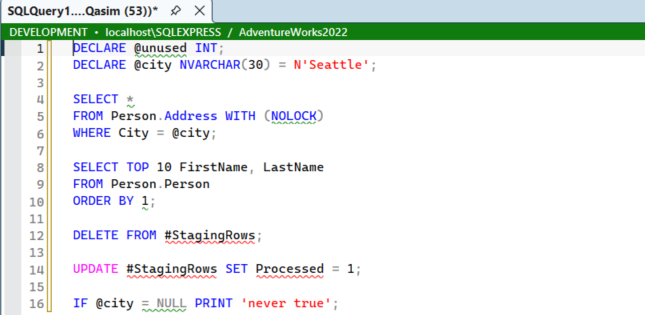

*Issues underlined as you type: an unused variable, `SELECT *`, a `NOLOCK` hint, `ORDER BY` ordinal and a comparison with `NULL`.*

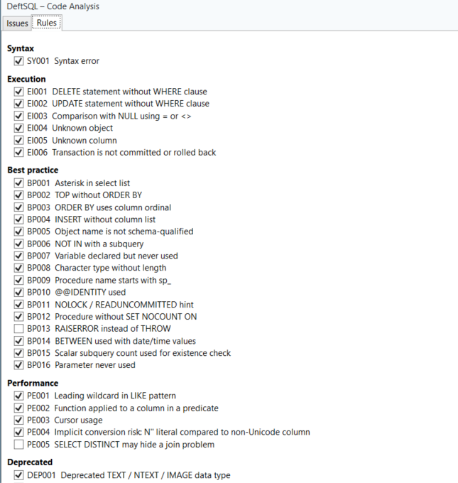

*Turn rules on or off and share them as a team rule set.*

### Refactoring
- **Smart rename (F2):**
  - Renames aliases, variables, CTEs and temp tables everywhere in the script.
  - For tables, views, procedures, functions and columns, it generates a reviewable script that renames the object and updates every dependent object in one transaction.
- **Qualify object names:** adds schema prefixes everywhere.
- **Insert semicolons:** ends every statement with one.
- **Add or remove square brackets.**
- **Uppercase or lowercase keywords.**
- **Encapsulate as stored procedure.**
- **Script query results as `INSERT`, `UPDATE` or `DELETE` (Ctrl+B, Ctrl+D):**
  - Run a SELECT, then turn its rows into statements in a new query window.
  - Works through aliases and joins: columns are mapped back to their real table, and the primary key is ticked for you.
  - **Several tables at once:** tick every table of a join; parents and children are put in foreign-key order.
  - **Join-based UPDATE / DELETE:** one statement per table that reuses your query's own joins and `WHERE`,
    instead of one statement per row. Alias a value with the target column's name to set it, e.g. `p.LastName AS JobTitle`.
  - Primary keys you didn't select are fetched automatically, so each table can still be matched.
  - You can also target another table, such as an archive copy.
  - Computed and rowversion columns are skipped, identity values are kept.
  - The script is wrapped in a transaction; you choose `COMMIT` or `ROLLBACK`.
- **Split Table:** move some columns of a table into a new table with the same primary key, for example address
  columns from `dbo.Customer` into `dbo.CustomerAddress`.
  - Pick the columns and name the new table; DeftSQL opens a script for you to review.
  - The script creates the table, copies the data, and moves the indexes, foreign keys, defaults and check
    constraints of those columns, all in one transaction.
  - It finishes by listing the views and procedures that use the moved columns, so you can update them.
  - On the Refactor menu, the DeftSQL toolbar and the editor's right-click menu.
- **Generate CRUD Procedures:** put the caret on a table name and get `Get`, `Insert`, `Update` and `Delete`
  stored procedures as a script to review.
  - Tick the procedures you want and choose a name pattern such as `{Table}_{Action}` or `usp_{Table}{Action}`.
  - Rows are found by the primary key (or a unique index, or the identity column).
  - Insert skips identity and computed columns, uses column defaults when a parameter is `NULL`, and returns the
    new identity value. Update reports an error when no row matches; a `rowversion` column protects Update and
    Delete from overwriting someone else's change.
  - On the Refactor menu and the editor's right-click menu.
- **Generate MERGE / Upsert:** a reviewable `MERGE … WITH (HOLDLOCK)` (or `UPDATE` then `INSERT`) for a table from
  another table, a temp table or a query. Only rows that really changed are updated (NULL-safe), with optional delete
  of missing rows and `OUTPUT $action`.
- **Paste as SQL (Ctrl+B, Ctrl+V):** cells copied from Excel, a CSV file or a grid become `INSERT` statements, a temp
  table, a `VALUES` list or a `MERGE`. The header row and separator are detected for you.
- **Convert SELECT ⇄ UPDATE / DELETE (Ctrl+B, Ctrl+T):** turn the SELECT you used to check the rows into the
  `UPDATE` or `DELETE` with the same `FROM` and `WHERE`, and back again.
- **Rewrite (Ctrl+B, Ctrl+R):** `IN (subquery)` → `EXISTS` or `JOIN`, derived table → CTE, and string `EXEC` →
  `sp_executesql` with real parameters.
- **Change Procedure Signature:** add, remove, reorder or rename parameters; the script alters the procedure and
  updates every `EXEC` of it in the database.


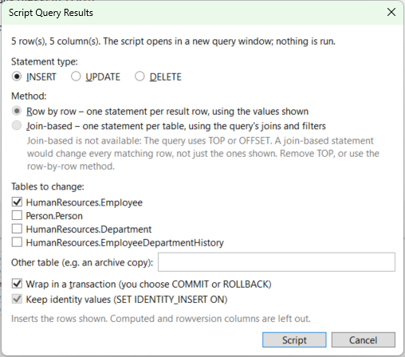

*Script Query Results: choose the statement type, the method and the tables to change...*

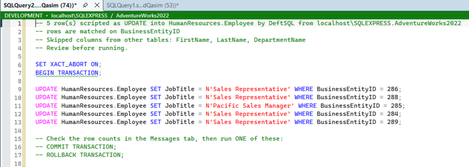

*...then review the generated script, wrapped in a transaction.*

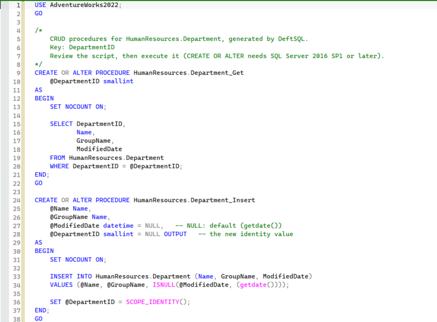

*Generate CRUD Procedures for `HumanResources.Department`.*

### Performance tuning
- **Profile Query (Ctrl+B, Ctrl+P):** runs the statement at the caret with statistics and the actual plan (data changes
  are rolled back) and shows reads per table, CPU and elapsed time, the costliest plan operators and findings with advice:
  missing indexes (with a `CREATE INDEX` script), implicit conversions, spills, key lookups, memory grants, bad row estimates and more.
- **Compare runs:** pick two runs, before and after a fix, and see what changed.
- **Estimated Plan Insights (Ctrl+B, Ctrl+M):** the same findings without running the query.
- **Analyze from clipboard:** paste Messages-tab statistics or plan XML.
- **Live Sessions:** running requests, the blocking tree with its lead blocker, waits and SQL text, refreshed every 5 seconds
  (needs `VIEW SERVER STATE`).

### Results grid
Right-click the SSMS results grid and choose **DeftSQL**:
- **Copy as IN list:** turns the selected values into `(1, 2, 3)` or `(N'A', N'B')`, ready for `WHERE … IN`.
- **Copy as CSV**, with column names.
- **Open in Excel:** a real Excel file with a frozen header and filters; codes such as `00123` keep their zeros.
- **Script Rows as INSERT:** turns the selected rows into `INSERT` statements.
- **Copy as JSON**, **Copy as Markdown Table** (for tickets and wikis) and **Copy as VALUES** (`SELECT * FROM (VALUES …) AS v (…)`).
- **Script as Temp Table:** `CREATE TABLE #Results` with column types inferred from the values, plus the rows as `INSERT`s.
- **Totals in the status bar:** select cells to see Count, Sum, Avg, Min, Max and Distinct, like Excel.
- **Find in Results:** filter every row of a result as you type, then jump to the matching cell in the grid.
- **View Cell Value:** see a long value in full, with JSON and XML indented.
- **Compare with Baseline:** keep one result, run the query again and see exactly which rows and cells changed.
- **Script as MERGE / Upsert:** upsert the selected rows into a table, matched on its key.

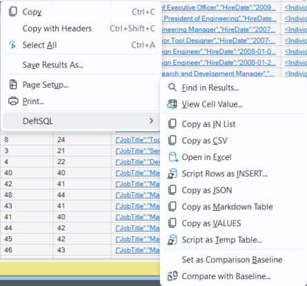

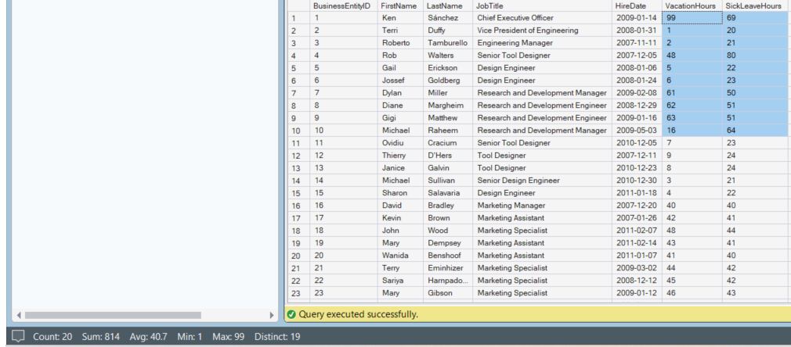

*Select cells and Count, Sum, Avg, Min, Max and Distinct appear in the status bar.*

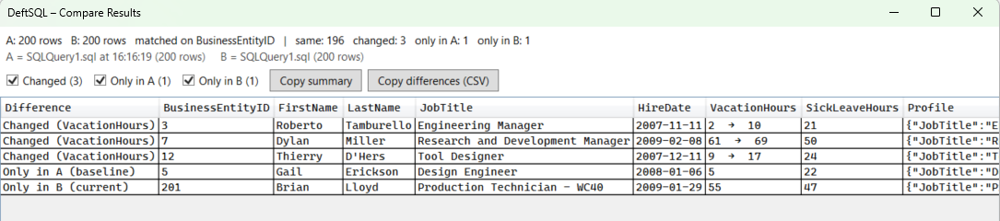

*Compare with Baseline after an `UPDATE`: changed cells as old → new, and rows only in A or only in B.*

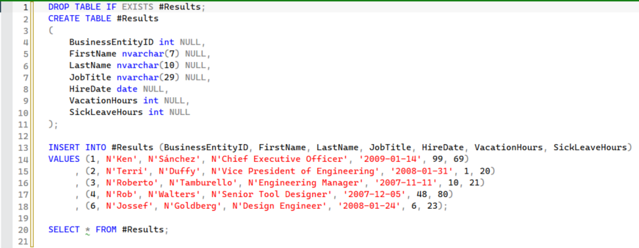

*Script as Temp Table: column types inferred from the values.*

The same commands are under **Extensions ▸ DeftSQL ▸ Results Grid**, the editor's right-click menu and the **Results Grid** dropdown on the toolbar.

### Settings and teams
- **Export Settings… / Import Settings…** move all your options and snippets to another PC in one file. API keys are never included.

### Navigation
- **Find Object:** search every table, view, procedure and column, with wildcards.
- **Go to Definition (F12)** for any name: variables, CTEs, temp tables and aliases jump to their declaration; tables,
  procedures, `EXEC` targets, synonyms and objects in other databases open their definition. **Alt+Left** goes back.
- **Search in Definitions (Ctrl+B, Ctrl+J):** search the code of every procedure, view, function, trigger and SQL Agent
  job step in all databases.
- **Find All References (Shift+F12):** what uses an object and what it uses, as a tree.
- **Ctrl+F12:** select that object in Object Explorer.
- **Shift+F5:** run just the statement under the caret.
- **Script Summary:** an outline of every statement in a long script.
- Hover over a table or column to see its details, including where a column is used: procedures, keys, indexes and constraints.


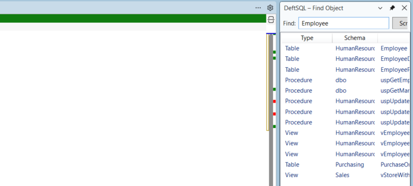

*Find Object: search tables, views, procedures and columns across schemas.*

### Query and tab history
- **Query History** records every query you run. You can search it and mark favorites.
- **Tab History (Ctrl+Q)** saves your query tabs every 30 seconds, so you can reopen tabs you closed or lost in a crash.
- Optionally, the tabs that were open when SSMS closed are reopened on startup.

### Environment tab coloring and safety
- A colored bar above each query window shows which environment you are on: **Production**, **Staging**, **Test** or **Dev**.
- DeftSQL asks for confirmation before running:
  - `DELETE` or `UPDATE` without a `WHERE` clause,
  - `DROP` or `TRUNCATE`,
  - anything on a production connection.

### AI assistant (optional)
- **Text to SQL:** describe what you want in plain English and get the query.
  - DeftSQL sends the model only the tables your question needs (matched on table and column names and the
    database's own column descriptions), how they join, and a ready-made `FROM … JOIN` clause.
  - The generated SQL is compiled on the server without running it. If a column or table is wrong, DeftSQL tells
    the model which table really has that column and how to join it, and lets it correct itself (up to three times).
  - If a problem remains, it is listed in a comment above the query so you know to review it.
- **Explain SQL**, **Optimize**, **Fix errors** and **Index analysis**.
- An **Assistant chat** window.
- Choose the AI engine:
  - **Claude:** your own Anthropic API key, stored encrypted on your PC.
  - **Local and fully offline:** install [Ollama](https://ollama.com), run `ollama pull qwen2.5-coder:7b` (or `qwen2.5-coder:3b` on 8 GB PCs), then set **Provider = Ollama** in Tools ▸ Options ▸ DeftSQL ▸ AI. Nothing leaves your computer.
- Table data is never sent. Offline explain and index analysis work without any AI.

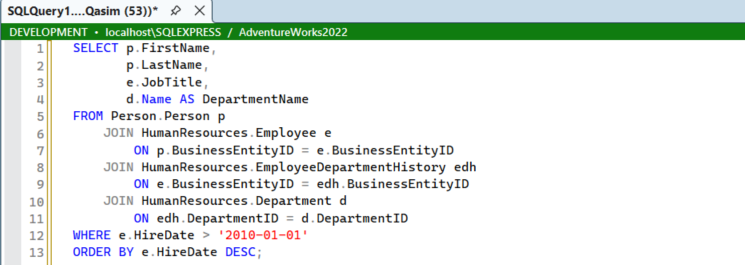

*Text to SQL with a local model, fully offline: the right schemas, joins on the right keys, filter and sort.*

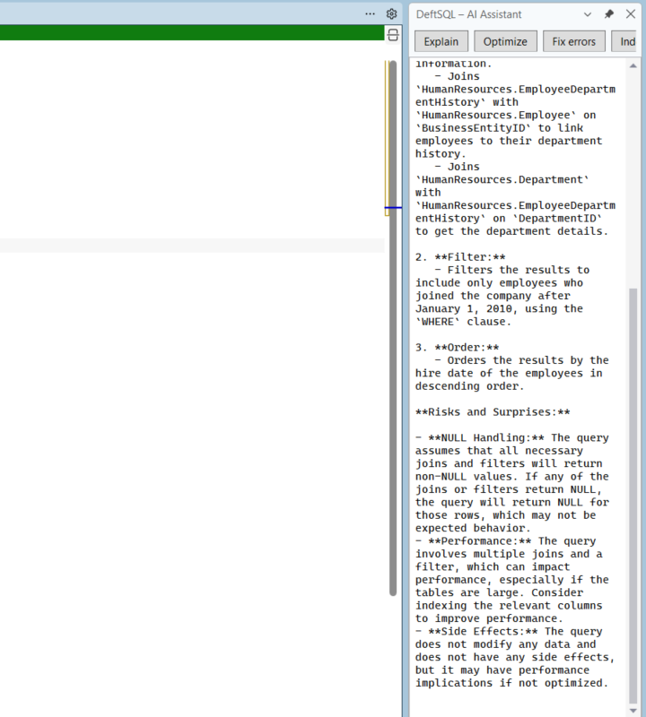

*Explain SQL in the AI Assistant window.*

---

## Keyboard shortcuts

| Shortcut | Command |
|---|---|
| Ctrl+K, Ctrl+Y | Format SQL |
| Tab | Expand snippet / expand `*` |
| Ctrl+Space | Show suggestions |
| Ctrl+. | Quick fixes & refactorings |
| F2 | Smart rename |
| F12 | Go to definition |
| Alt+Left | Navigate back |
| Shift+F12 | Find all references |
| Ctrl+F12 | Select in Object Explorer |
| Shift+F5 | Execute current statement |
| Ctrl+Q | Tab history |
| Ctrl+Shift+D | Refresh suggestions |
| Ctrl+Shift+P | Suggestions on/off |
| Ctrl+B, Ctrl+W | Expand wildcards |
| Ctrl+B, Ctrl+Q | Qualify object names |
| Ctrl+B, Ctrl+B | Add/remove square brackets |
| Ctrl+B, Ctrl+C | Insert semicolons |
| Ctrl+B, Ctrl+E | Encapsulate as stored procedure |
| Ctrl+B, Ctrl+D | Script query results as INSERT / UPDATE / DELETE |
| Ctrl+B, Ctrl+T | Convert SELECT ⇄ UPDATE / DELETE |
| Ctrl+B, Ctrl+R | Rewrite |
| Ctrl+B, Ctrl+V | Paste clipboard as SQL |
| Ctrl+B, Ctrl+J | Search in definitions |
| Ctrl+B, Ctrl+P | Profile query |
| Ctrl+B, Ctrl+M | Estimated plan insights |
| Ctrl+B, Ctrl+U / Ctrl+L | Keywords upper / lower case |
| Ctrl+B, Ctrl+S | Script summary |
| Ctrl+B, Ctrl+F | Find unused variables and parameters |
| Ctrl+B, Ctrl+O | Find object |
| Ctrl+B, Ctrl+G | Select current statement |
| Ctrl+B, Ctrl+H | Query history |
| Ctrl+B, Ctrl+N | Code analysis |
| Ctrl+B, Ctrl+A | Text to SQL |
| Ctrl+B, Ctrl+X | Explain SQL |
| Ctrl+B, Ctrl+I | AI assistant |

---

## Version history

### 2.9.0 (17 November 2026): performance tuning, navigation and code generation
- **Performance:** Profile Query (reads per table, CPU and time, plan findings with advice), Estimated Plan Insights,
  Query Runs with before/after compare, statistics or plan XML analyzed from the clipboard, and Live Sessions with the blocking tree.
- **Navigation:** Go to Definition (F12) for any name, with Alt+Left to go back; Search in Definitions across all databases
  and SQL Agent jobs; Find All References (Shift+F12); code folding for `--region`, `BEGIN … END`, `TRY/CATCH` and `CASE`.
- **Code generation:** Generate MERGE / Upsert, Paste as SQL from Excel or CSV, Convert SELECT ⇄ UPDATE / DELETE,
  Rewrite (`IN` → `EXISTS`/`JOIN`, derived table → CTE, `EXEC` → `sp_executesql`) and Change Procedure Signature.
- **Results grid:** Script as MERGE / Upsert.
- **Code analysis:** 4 new rules for filters that can't use an index (76 rules in total).
- **Fix:** Script as Temp Table now uses the base type of user-defined alias types (such as AdventureWorks' `dbo.Name`), so the script runs in tempdb.

### 2.8.0 (16 November 2026): Generate CRUD Procedures
- Get, Insert, Update and Delete procedures for a table as a reviewable `CREATE OR ALTER` script, with a name pattern,
  the new identity value as `OUTPUT`, column defaults, and optimistic concurrency on `rowversion` columns.

### 2.7.0 (13 November 2026): results grid tools
- Totals of the selected cells in the status bar, Find in Results, View Cell Value (JSON and XML indented) and Compare with Baseline.
- Copy as JSON, Markdown Table and VALUES; Script as Temp Table with inferred column types.
- DeftSQL windows keep their own keyboard input (Backspace and the arrow keys no longer edit the query behind them).

### 2.6.2 (13 November 2026)
- Split Table button on the DeftSQL toolbar.

### 2.6.1 (13 November 2026)
- Split Table in the query editor's right-click menu.

### 2.6.0 (13 November 2026): teams, results grid and Split Table
- Completion ranked by usage, hidden objects, and completion for other databases on the same server.
- Formatting: object names in the database's case, more layout options, team styles and Format SQL Files.
- Code analysis: 33 new rules (72 in total), suppression comments and team rule sets.
- Split Table; results grid Copy as IN list, Copy as CSV, Open in Excel and Script Rows as INSERT.
- Export / Import Settings, 140 built-in snippets and the `deftsql` command line for CI.

### 2.5.2 (13 November 2026)
- The DeftSQL submenu appears in the SSMS 22 query editor's right-click menu.

### 2.5.1 (13 November 2026): smarter Text to SQL and the toolbar
- Text to SQL sends only the relevant tables, uses column descriptions and foreign-key join paths, compiles the result
  on the server and lets the model correct itself.
- Script Query Results: several tables at once, join-based UPDATE / DELETE, hidden primary keys and foreign-key order.
- DeftSQL toolbar, and parameter info for procedures and functions.

### 2.2.0 (12 November 2026): script query results and offline AI
- Script Query Results as INSERT / UPDATE / DELETE (Ctrl+B, Ctrl+D).
- Local AI through Ollama or any OpenAI-compatible server, fully offline.
- Formatting of the dynamic SQL inside `EXEC sp_executesql`.

### 2.0.0 (11 November 2026): QueryCraft is now DeftSQL
- New name and extension ID; settings, snippets and history move over automatically.

### 1.1.8 (11 November 2026, as QueryCraft)
- Works with every SSMS 22.x release.
- Security: passwords are masked in query history and AI requests, and Script as INSERT runs only a read-only SELECT.

### 1.1.6 (11 November 2026, as QueryCraft)
- Fix: completion after `FROM schema.` lists that schema's objects.

### 1.1.5 (11 November 2026, as QueryCraft)
- First release.

---

## Installation

1. Download **DeftSQL.vsix**.
2. Close SSMS.
3. Double-click `DeftSQL.vsix` and follow the installer.
4. Start SSMS. You'll find everything under **Extensions ▸ DeftSQL**, in the query editor's right-click menu,
   and on the **DeftSQL toolbar** (Format, Snippets, Find Object, Code Analysis, Split Table, Script Results, Profile Query, Search in Definitions,
   Live Sessions, Find in Results,
   View Cell Value, Compare with Baseline, the Results Grid menu, Text to SQL,
   Explain, Optimize, AI Assistant, Query and Tab History, Refresh, Options, and a label showing which AI model
   answers). Show or hide the toolbar with **View ▸ Toolbars ▸ DeftSQL**.
5. Recommended: turn off SSMS's built-in IntelliSense list so you don't get two popups.
   It's under **Tools ▸ Options ▸ Text Editor ▸ Transact-SQL ▸ IntelliSense**.

| Extensions ▸ DeftSQL | Right-click in a query window |
|---|---|
| 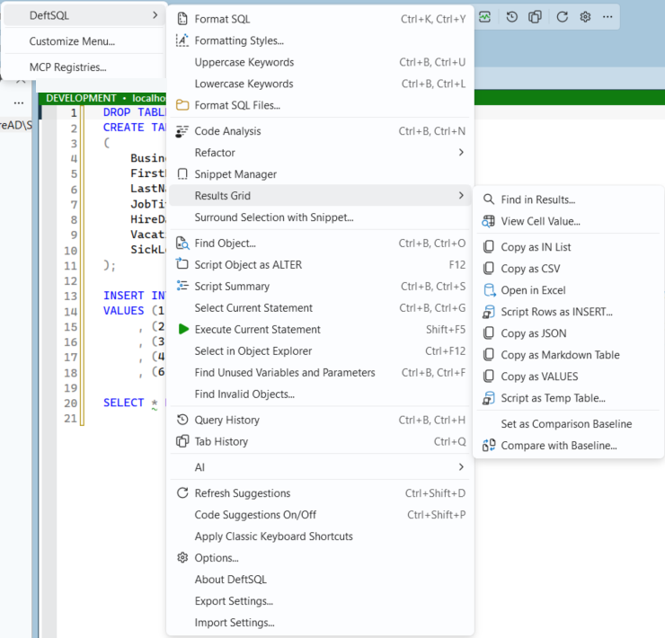 | 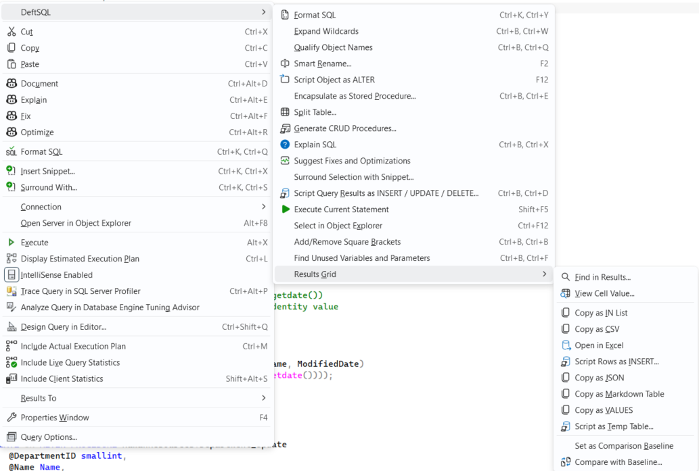 |


Settings are under **Tools ▸ Options ▸ DeftSQL**.

**Requirements:**
- SQL Server Management Studio 22 (any 22.x release).
- SQL Server 2008 or later. Generated rename scripts use `CREATE OR ALTER`, which needs SQL Server 2016 SP1 or later.

**To uninstall:** close SSMS, then run in Command Prompt:
```
"C:\Program Files\Microsoft SQL Server Management Studio 22\Release\Common7\IDE\VSIXInstaller.exe" /uninstall:DeftSQL.SSMS.4b8f2c1e-7a3d-4e5f-9c6b-2d1a0e9f8b7c
```

---

Developed by **Syed Muhammad Qasim**.

DeftSQL is an independent product. It is not affiliated with, endorsed by or sponsored by any other
software vendor. All product names are trademarks of their respective owners.
