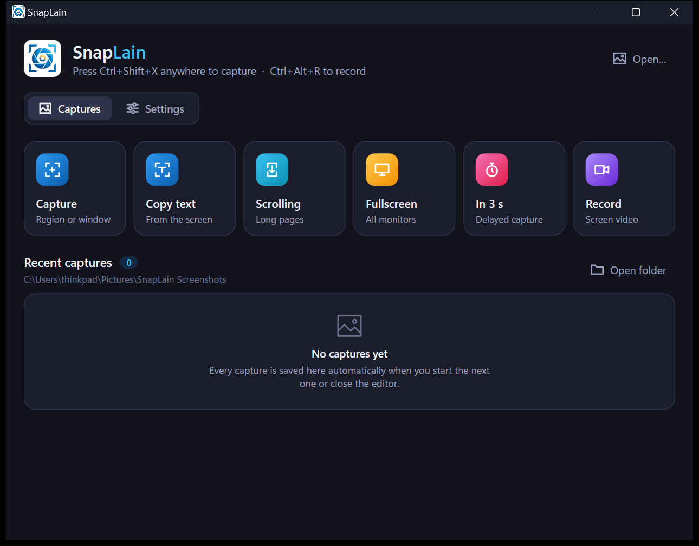
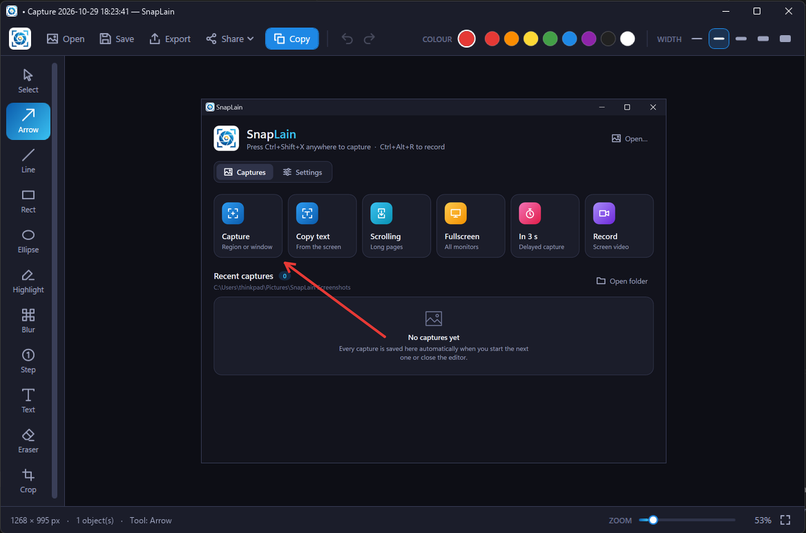
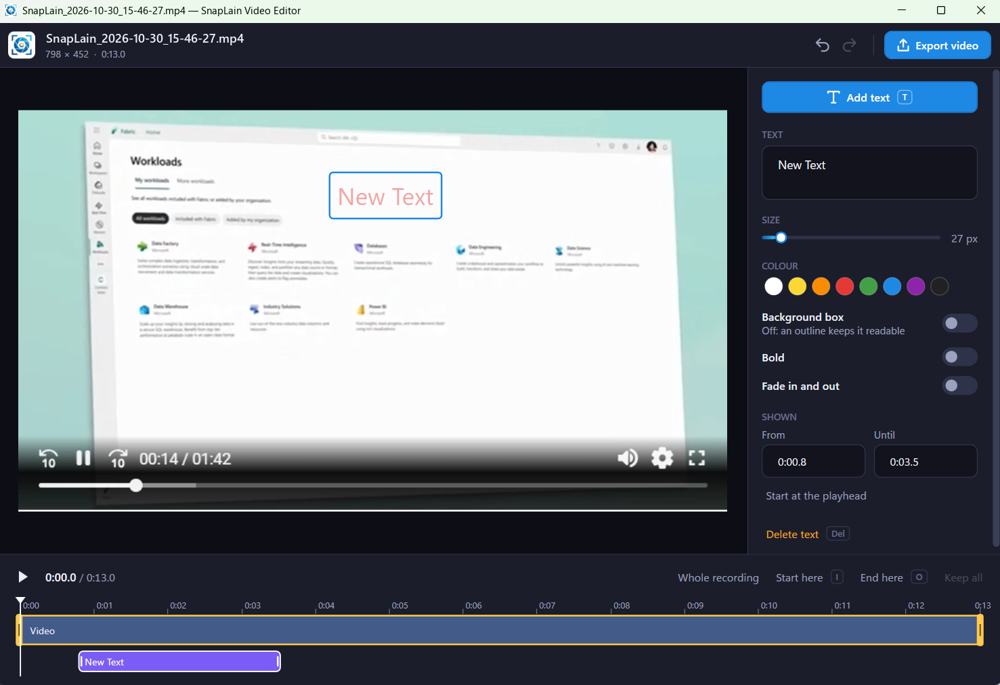
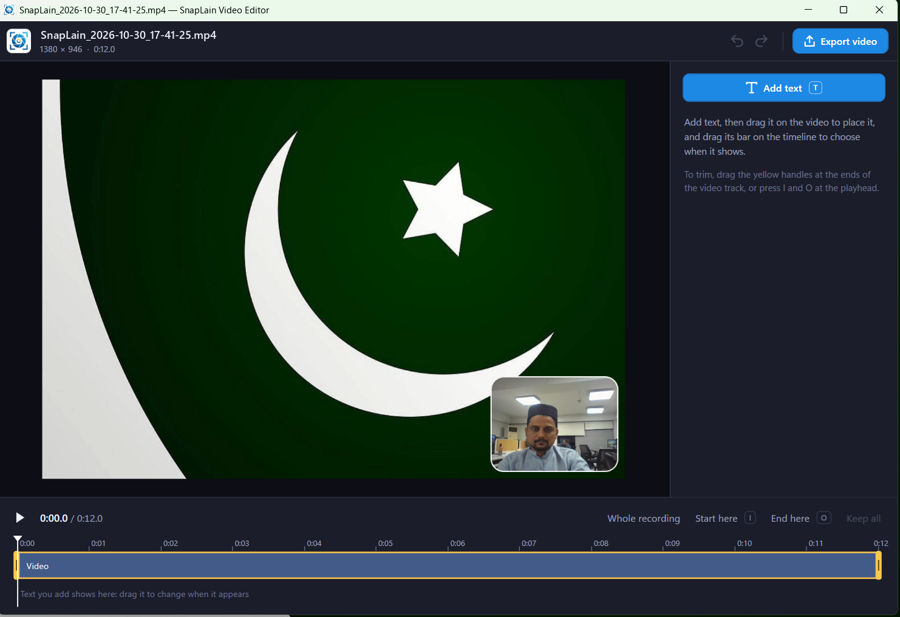

# SnapLain for Windows

**SnapLain** is a Windows screen-capture, screen-recording, video-editing and annotation tool.
Grab a region, a window, a whole scrolling page or the full screen, mark it up, record your screen with your voice
and webcam, then trim and caption the video and share it — all from one small app that lives in the system tray.

Version **0.10.0** · Windows 10 or later (x64)

## Download

| Package | Size | Best for |
|---|---|---|
| [SnapLain-Setup-0.10.0.exe](https://github.com/qasimshah0321/Setups/raw/main/SnapLain/SnapLain-Setup-0.10.0.exe) | ~6 MB | Most people. Installs for the current user without an admin prompt. Downloads the .NET 8 Desktop Runtime from Microsoft if the PC doesn't have it. |
| [SnapLain-0.10.0-x64.msi](https://github.com/qasimshah0321/Setups/raw/main/SnapLain/SnapLain-0.10.0-x64.msi) | ~56 MB | Offline installs and IT deployment. Self-contained (.NET runtime included), installs for all users. |
| [SnapLain-Setup-0.10.0-Store.exe](https://raw.githubusercontent.com/qasimshah0321/Setups/main/SnapLain/SnapLain-Setup-0.10.0-Store.exe) | ~50 MB | Microsoft Store (EXE submission) and silent installs. Self-contained (.NET included), installs for all users, no prerequisites. |
| [SnapLain-0.10.0.msix](https://github.com/qasimshah0321/Setups/raw/main/SnapLain/SnapLain-0.10.0.msix) | ~69 MB | Microsoft Store submission. This package is **unsigned** (the Store signs it), so Windows won't install it by double-clicking — use the .exe or .msi for normal installs. |

SHA-256:
- `SnapLain-Setup-0.10.0.exe`: `0A1E6EDAA5E898B625C3EA9846B11A43FEB3B05E0C6E9783555574A95CBA38E7`
- `SnapLain-0.10.0-x64.msi`: `487B563D742FC7F8373A0CA56CD21DBAA1E2AFE6AA4349134D32D155FC47AB58`
- `SnapLain-Setup-0.10.0-Store.exe`: `E74AA39EDE2DEB82995F949A934CF3AB4CE8A5DADADF4448C8424A55652B0BBA`
- `SnapLain-0.10.0.msix`: `B92C776C0079A14AB529EF08542BEB1349228653E6060BD19FB2F5CBEBF97988`

> Previously called **Pixora** / **SnapIT**. Old `.pixora` and `.snapit` projects still open, and older captures stay in your history.

### Microsoft Store submission (MSI/EXE app)

In Partner Center › Packages, use the **direct** links below (the `github.com/.../raw/...` links redirect, which
the Store validation may not follow):

| Package | Package URL | Installer parameters |
|---|---|---|
| EXE | `https://raw.githubusercontent.com/qasimshah0321/Setups/main/SnapLain/SnapLain-Setup-0.10.0-Store.exe` | `/VERYSILENT /SUPPRESSMSGBOXES /NORESTART /SP-` |
| MSI | `https://raw.githubusercontent.com/qasimshah0321/Setups/main/SnapLain/SnapLain-0.10.0-x64.msi` | none needed (MSI installs silently by itself) |

- Architecture **x64**, language **English**.
- Add or remove programs entry: name **SnapLain**, publisher **SnapLain**, so the app name and the publisher display name in Partner Center should match these.
- Don't submit `SnapLain-Setup-0.10.0.exe` (the small one): when .NET is missing it downloads the runtime and asks for administrator approval separately, so it can't install fully silently.

### Install
1. Download one of the packages above.
2. Run it. If Windows SmartScreen shows "Windows protected your PC", click **More info › Run anyway**.
3. The setup adds a Start menu shortcut and can optionally add a desktop shortcut and start SnapLain when you sign in.

Uninstall from **Settings › Apps**. Your captures and settings are kept.

---

## Screenshots

**Main window** — start a capture or recording, browse recent captures, change settings.

**Editor** — annotate with arrows, shapes, highlights, blur, numbered steps, text and more.

**Video editor** — text over a recording, timeline, trim and cut.

**Camera bubble in recordings**

---

## Features

### Screen capture
- **All-in-one capture**: the screen freezes; drag to select a region or click to grab the highlighted window.
- **Fullscreen** capture across all monitors.
- **Delayed capture**: wait 1, 2, 3, 5 or 10 seconds so you can open a menu first. A countdown badge shows in the corner without stealing focus and is left out of the shot; Esc cancels.
- **Scrolling capture**: pick a scrolling area or window; SnapLain scrolls it and stitches one tall image. Sticky headers/footers are kept once and moving scrollbars are trimmed. Esc stops early.
- **Copy text from the screen (OCR)**: drag over any text — even inside a picture or a paused video — and it goes to the clipboard. Works offline using the OCR engine built into Windows, in any language installed in Windows.
- **Global shortcuts**: **Ctrl+Shift+X** to capture, **Ctrl+Alt+R** to record (both changeable).
- Per-monitor DPI aware, so captures are in real physical pixels.

### Screen recording
- Record an area, a window, or press **F** for the whole screen. A simple bar shows the area size, Full screen, mic/system-sound/camera status, **Record** (Enter) and **Cancel** (Esc).
- Records **microphone** and **system sound**, mixed into one track, each with an on/off switch and a **live level meter**. Choose which microphone when several are connected.
- Optional **3-second countdown**.
- **Webcam bubble**: your camera in a rounded or circular bubble on the video — Small / Medium / Large, mirrored or not, choice of camera. Drag it anywhere and scroll to resize while recording; SnapLain remembers the spot. The camera is drawn into the video itself (sharp at any scaling).
- Saves an **MP4** (H.264, 30 fps, with the mouse pointer, AAC audio), using the graphics card's encoder when available.
- Small toolbar with timer, **Pause/Resume** and **Stop**; a red outline marks the area. Neither appears in the video, and the toolbar never takes focus from the app you're recording.
- Stop from the toolbar, the tray menu or the shortcut. Graceful handling if a mic/camera is blocked or missing — recording carries on and a notification explains why.

### Video editor
- **Text over the video**: add text (T, or double-click on the video), drag it into place; set size, colour, bold, a background box or outline, and fade in/out.
- **Timeline**: each text is a bar — drag to change when it shows, or drag its ends; edges snap to the playhead; exact times can be typed.
- **Trim** start and end with the yellow handles, or **I** / **O** at the playhead.
- **Cut out** sections in the middle (X); playback skips cuts so you see exactly what will be exported.
- Play/pause (Space), frame stepping (← →), undo/redo; edits are kept between sessions.
- **Export video** (Ctrl+E) to a new `…_edited.mp4` — the original is never changed. Faster than real time on the GPU, with progress and Cancel.
- **Export GIF**: Small (480 px), Medium (800 px), Large (1280 px) or full size, looping, optimised to stay small.

### Image editor
- Tools: **Select/move, Arrow, Line, Rectangle, Ellipse, Highlight, Pen, Blur/pixelate, numbered Step, Text, Eraser, Crop** — each with a one-key shortcut. Hold Shift for 45° lines, squares and circles.
- **Arrows & lines**: straight or curved, solid/dashed/dotted, filled or open heads in four sizes, on one or both ends.
- **Shapes**: rectangle, rounded rectangle, ellipse, triangle, diamond — with outline and fill colours, opacity (10–100%) and thickness.
- **Text** typed directly on the picture with font, size, bold and italic.
- **Colours**: 8-colour palette, any colour via the Windows colour dialog, and an **eyedropper** to pick colours from the screenshot.
- **Eraser** removes markup while the screenshot stays intact.
- **Image menu**: rotate, flip, and resize (pixels or percent).
- **Crop to clipboard** and **paste** pictures as movable pieces; **File › New** for a blank canvas.
- **Copy text (OCR)** from the picture (Ctrl+Shift+C) — blurred areas stay unreadable.
- Full undo/redo, zoom and fit, complete menu bar with keyboard shortcuts.

### Save, export & share
- Every capture is **auto-saved** to `Pictures\SnapLain Screenshots` (or your chosen folder).
- Save as an editable **`.snaplain` project**, export **PNG / JPEG / BMP / PDF** (long captures span several A4 pages), or copy to the clipboard.
- **Share**: Print, **Email** (image attached in your default mail app), **WhatsApp** (Desktop or Web), or the Windows share panel.

### Capture history
- The main window lists captures and recordings newest first, with thumbnails, time, size and dimensions (or video length).
- Double-click to open in the editor or play a recording; hover for Edit / Copy / Show in folder; **Edit video** for recordings.

### Runs in the background
- Lives in the **system tray**: closing the window keeps shortcuts active. Right-click the tray icon for Capture, Scrolling, Copy text, Fullscreen, Delayed, Record screen, Settings and Exit.
- Only one SnapLain runs at a time.
- Optional **Start with Windows** (starts quietly in the tray).

### Settings
- Change shortcuts (conflicts with other apps are refused), delay length, recording sources and camera, and save location (with an offer to move existing captures).
- **Automatic update check** once a day via GitHub's public releases API — nothing about you or your PC is sent. **Download and install** from the tray, or turn it off.

---

## Requirements
- Windows 10 or Windows 11, 64-bit
- .NET 8 Desktop Runtime (installed automatically by the setup .exe; already included in the .msi)
